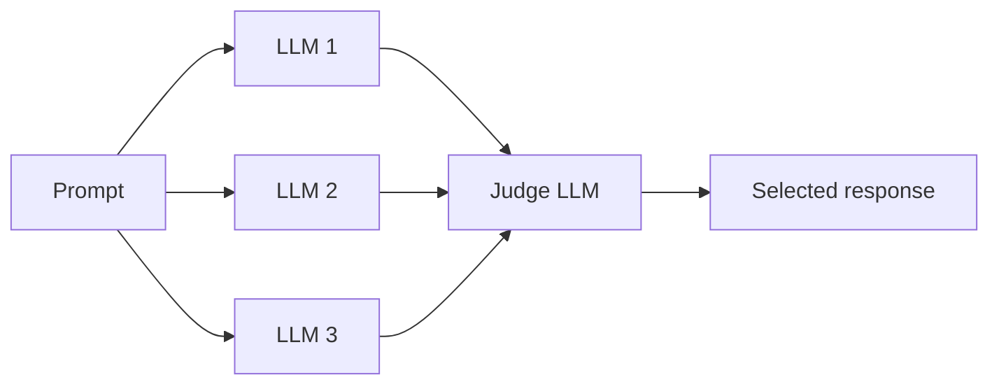
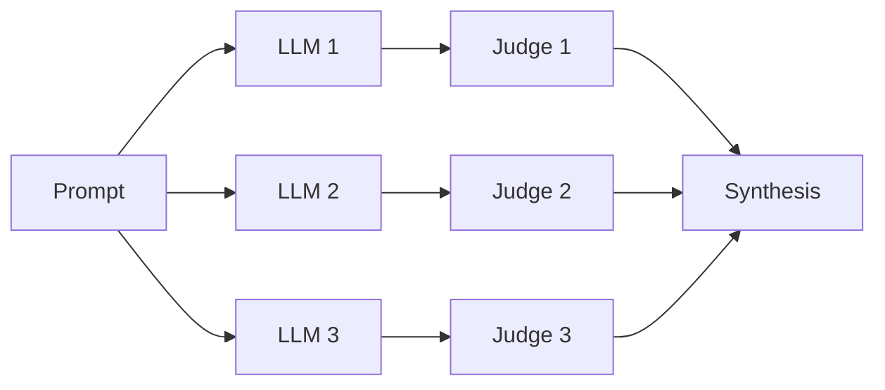
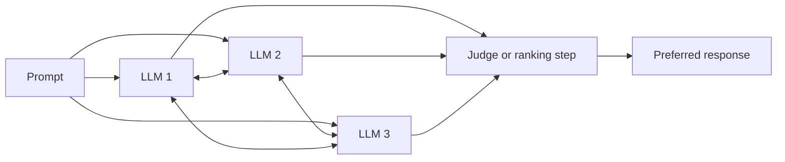

*Originally written April 10, 2026; published November 24, 2026.*

## My experience so far
LLMs do not follow system prompts or user instructions as much as we want them to. Sometimes this is not a big deal, and the interpretation of the user's prompt leaves out important details that the LLM ends up following during the implementation of the work. Sometimes this is minor, sometimes it leads you down a wrong development time waste of tokens, or worse, its wrong when working on live resources.

We don't fully understand how these things work, and the mathematics around generating the next token in a response does not understand any idea of intent. We need to divorce away the idea that they are intending to do one thing or another, they are just giant probability machines. This does not stop me from cursing when Claude goes off the rails and starts to come up with a new novel ways of doing something that is a well trodden path in the language or framework I'm working with. This seems to be the failure case that I have the most problems with. When It wastes tokens on a solution that does work, but either completely ignores that the rest of the project uses Framework Y and it decides to introduce Framework X or Framework 2Y because it never reads enough of the context.

This is a problem that we battle trying to get these to automate as much as my dayjob and eventually my hobby work. So how do you counteract it? I've been working with LLM as a judge as a possible solution for these types of uncertainties, but still do not quite trust this as the long term nor foolproof method of geting these to work.

One of the things I had been experimenting with was having an LLM judge whether or not a page should offer to provide A2UI view for the given information. In this case, we were talking to multiple backends that could be returning charts, lists, images, etc that would correspond to a different A2UI component we supported. It was low stakes, and because the session is interactive we are fine to correct the session quickly without going down the wrong path for subsequent steps in an automation or chat session.

So why do I still not trust it? Because context is so inconsistent that I can't depend on something the user said previously in a conversation isn't affecting the overall execution of this completion vs the next.

# What I think will work

If we really want these things to go on long runs of implementation and automation, we need to figure out how to give these guardrails that aren't just about safety, but about verification. I think of a simple consensus algorithm often: take the same request send it to three llms, have the three responses compared by a fourth LLM. I'm totally going to trust that fourth one right? Do I ask the fourth llm to compare them all against each other? Do I ask it if each one is better than the last? Do I ask it do any of these responses look odd? What questions can we ask for verification that aren't very specific to the problem step being worked on, or hint the LLM towards certain phrases. I don't think there's a good answer to this question



This is the basic pattern.



This is another possible pattern.



There's probably a few more LLM as judges strategies I'm missing out on here, but I think I can get to the idea that I have.

At this point I think it is a question of pointing enough compute at these problems to get 'solid' code that is 'verifiable' and testable. I think if you really had an unlimited budget and patience running every prompt and checkpoint multiple times and picking and choosing the best response and keep going would I think be more fool proof as a 'one-shot' type of development that people truly want to achieve. 

So how do you implement something like this if you have some compute to spare? I would do something like this:


```
prompt: Write a webserver in golang with a hello world endpoint
```

```
static verifications:
1. Golang was used
2. There are tests
3. The tests pass
4. The tests aren't hardcoded to appease me
```

Now you start to get to more specific checks:

```
runtime verifications
1. is there an endpoint that returns hello world?
2. can i run the application and run an integration test?
3. are there failure and passing integration tests?
```

Immediately ask yourself, is the LLM checking all those things as well? No it's not checking them unless it's running something to verify that. If you want an LLM to do each of these checks you're introducing a certain percentage of uncertainty in the response being accurate, and you're still taking on the cost of token generation which may or may not be significant.

 *NOTE: The preceding was an original blog post I wrote, I think I was high on my own supply. I went with a complete different technique in the end, I'm still not certain I'm doing it right. I've been tracking metrics with my first 100% vibe coded harness and have found that I have 77% acceptance rate for factories' project. I'll talk about this when I'm done with some ideas.

